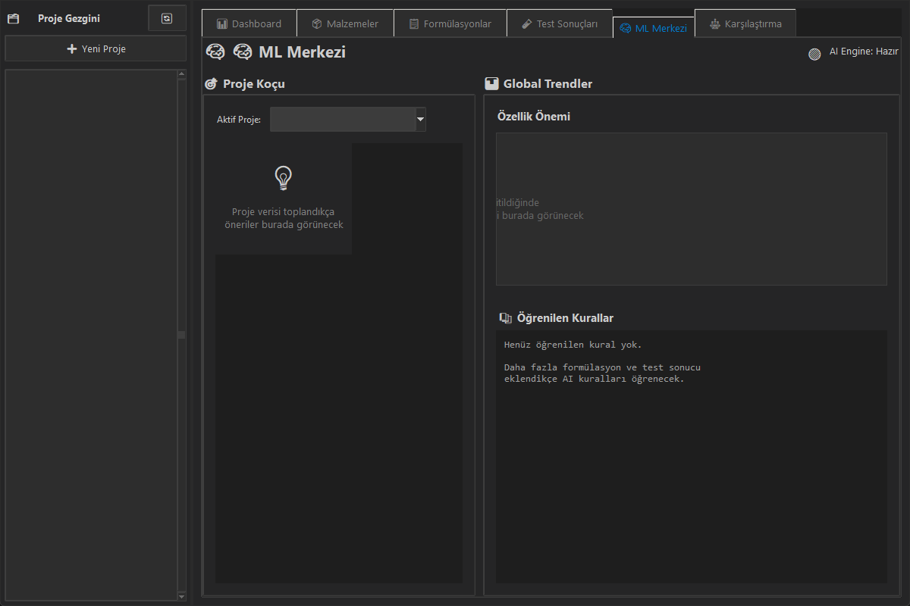

<div align="center">

# 🎨 Paint Formulation AI

[](https://www.python.org/)
[](LICENSE)
[]()

*Where Chemical Engineering meets Data Science - Kimya Mühendisliği ve Veri Biliminin Buluştuğu Yer*

[English](#english) | [Türkçe](#türkçe)

</div>

---

<br>

## <a name="english"></a> 🇬🇧 English

### 📋 About

**Paint Formulation AI** is a desktop application designed for paint and coatings R&D engineers. It streamlines the formulation development process by combining traditional recipe management with machine learning-powered predictions.

Built with Python and Tkinter, this tool helps reduce development cycles by intelligently analyzing historical data to predict coating performance before physical testing. It can work fully offline or in hybrid mode.

### ✨ Features

| Feature | Description |
|---------|-------------|
| 📊 **Smart Dashboard** | Real-time monitoring of R&D metrics and statistics |
| 🧪 **Formulation Editor** | Excel-style grid with real-time cost & solid content calculations |
| 🤖 **ML Predictions** | ML-powered predictions for quality, viscosity, and other tests |
| 💰 **Cost Analysis** | Automatic cost calculation based on material prices |
| 📁 **Project Management** | Hierarchical organization: Projects → Concepts → Trials |
| 📈 **Variation Comparison** | Side-by-side comparison of formulation variations |

### 🖼️ Screenshots

<div align="center">

| **Dashboard** | **Material Management** |
|:---:|:---:|
|  |  |

| **Formulation Editor** | **Test Results & Training** |
|:---:|:---:|
|  |  |

| **ML Center (AI Assistant)** | **Optimization & Comparison** |
|:---:|:---:|
|  |  |

</div>

### 🚀 Installation & Setup

**Windows (recommended):** install [Python 3.10+](https://www.python.org/downloads/) with
"Add python.exe to PATH", run `scripts\setup_windows.bat` once, then start the app with
`scripts\run_windows.bat`. To build a single-file EXE run `scripts\build_exe_windows.bat`
(output: `dist\PaintFormulationAI.exe`, no Python needed; also built by GitHub Actions). Data, models,
settings and logs are stored in `%LOCALAPPDATA%\PaintFormulationAI`, not next to the EXE.

**Manual (any platform):**
```bash
python -m venv venv
venv\Scripts\activate          # Linux/macOS: source venv/bin/activate
pip install -r requirements.txt
python app/main.py
```

**Workflow:** Project → Concept (formula name) → Variation (formula code) → recipe + test results.
Every save retrains the model in the background on recipe composition → test results (needs ≥ 3 tested
variations); the Optimization tab then suggests recipes for target properties. See the Turkish section
for a step-by-step guide.

---

<br>

## <a name="türkçe"></a> 🇹🇷 Türkçe

### 📋 Hakkında

**Paint Formulation AI**, boya ve kaplama Ar-Ge mühendisleri için tasarlanmış modern bir masaüstü uygulamasıdır. Geleneksel reçete yönetimini makine öğrenimi destekli tahminlerle birleştirerek formülasyon geliştirme sürecini kolaylaştırır.

Python ve Tkinter kullanılarak geliştirilen bu araç, fiziksel testlerden önce kaplama performansını tahmin etmek için geçmiş verileri akıllıca analiz ederek geliştirme döngülerini ve maliyetleri azaltmaya yardımcı olur. İnternet olmadan da (offline mod) tam yetkiyle çalışabilir.

### ✨ Özellikler

| Özellik | Açıklama |
|---------|-------------|
| 📊 **Akıllı Kontrol Paneli** | Ar-Ge metriklerinin ve istatistiklerinin gerçek zamanlı takibi |
| 🧪 **Formülasyon Editörü** | Gerçek zamanlı maliyet ve katı madde hesaplamalı Excel tarzı tablo |
| 🤖 **ML Tahminleri** | Kalite, viskozite ve parlaklık gibi değerler için Makine öğrenmesi desteği |
| 💰 **Maliyet Analizi** | hammadde fiyatlarına göre otomatik toplam maliyet hesaplaması |
| 📁 **Proje Yönetimi** | Hiyerarşik organizasyon: Projeler → Konseptler → Denemeler |
| 📈 **Varyasyon Karşılaştırması** | Formülasyon varyasyonlarının yan yana karşılaştırılması ve analizi |

### 🖼️ Ekran Görüntüleri

<div align="center">

| **Kontrol Paneli (Dashboard)** | **Hammadde Yönetimi** |
|:---:|:---:|
|  |  |

| **Formülasyon Editörü** | **Test Sonuçları ve Eğitim** |
|:---:|:---:|
|  |  |

| **ML Merkezi (Makine Öğrenmesi)** | **Optimizasyon ve Karşılaştırma** |
|:---:|:---:|
|  |  |

</div>

### 🚀 Kurulum

#### Windows (önerilen)

1. [Python 3.10+](https://www.python.org/downloads/) kurun; kurulumda **"Add python.exe to PATH"** seçeneğini işaretleyin.
2. Projeyi indirin (`git clone https://github.com/kadirayana/PaintsCoatingsML.git` veya GitHub'dan ZIP).
3. `scripts\setup_windows.bat` dosyasına çift tıklayın (bir kez; sanal ortamı kurar ve bağımlılıkları yükler).
4. Uygulamayı `scripts\run_windows.bat` ile başlatın.

**Tek dosya EXE (Python gerekmez):** `scripts\build_exe_windows.bat` → `dist\PaintFormulationAI.exe`
veya GitHub'da **Actions → Windows EXE** çalıştırmasının "Artifacts" bölümünden indirin. EXE herhangi bir
klasörden çalıştırılabilir; veriler (veritabanı, modeller, ayarlar, loglar) EXE'nin yanına değil
`%LOCALAPPDATA%\PaintFormulationAI` klasörüne yazılır. Hata durumunda ayrıntılar oradaki `logs\` klasöründedir.

#### Elle kurulum (tüm platformlar)

```bash
python -m venv venv
venv\Scripts\activate          # Linux/macOS: source venv/bin/activate
pip install -r requirements.txt
python app/main.py
```

### 🧭 Uygulama Nasıl Çalışır

Veriler şu hiyerarşide tutulur: **Proje → Konsept → Varyasyon → Reçete + Test sonuçları**

1. **Proje oluşturun:** Sol paneldeki "Yeni Proje" ya da editördeki proje butonu.
2. **Hammaddeleri girin** (Hammaddeler sekmesi): kategori, birim fiyat ve varsa fiziksel/kimyasal özellikler
   (OH değeri, Tg, yağ absorpsiyonu…). Özellikler ne kadar dolu olursa ML o kadar iyi öğrenir.
3. **Formülasyon kaydedin** (Formülasyonlar sekmesi): proje seçin, **formül adı = konsept**, **formül kodu =
   varyasyon**. Aynı adla kaydedilen kodlar aynı konseptin varyasyonlarıdır. Aynı kodu tekrar kaydederken
   üzerine yazmayı veya yeni revizyon (`-REV1`) açmayı seçebilirsiniz. Sol ağaçta bir konsepte sağ tıklayıp
   "Yeni Varyasyon" ile o konsepte hazır başlayabilirsiniz.
4. **Test sonuçlarını girin** (Test Sonuçları sekmesi): formül kodunu seçip ölçümleri yazın. Kalite skoru
   otomatik hesaplanır; skor ≥ 70 ✅, < 50 ❌ olarak ağaçta görünür.
5. **ML otomatik öğrenir:** Her kayıttan sonra model arka planda, reçete bileşimi (bağlayıcı/pigment oranı,
   P/B, katı madde…) → test sonuçları ilişkisini öğrenir. En az 3 test sonucu gerekir.
6. **Karşılaştırma:** Ağaçta bir konsepte tıklayın; varyasyonların reçete ve sonuçları yan yana, farklar
   vurgulu gösterilir.
7. **Optimizasyon:** Hedef değerleri (parlaklık, maliyet…) seçin; genetik algoritma eğitilmiş modelle
   uygun reçeteler önerir. "Bu Reçeteyi Uygula" ile editöre aktarıp kaydedebilirsiniz.

### 🧪 Testler

```bash
pytest                                  # birim testleri
python tests/workflow_harness.py        # arayüzü baştan sona süren akış testi (ekran gerekir)
```

---

<br>

## 📦 Tech Stack / Teknoloji Yığını

- **Language:** Python 3.10+
- **GUI:** Tkinter / ttk
- **Database:** SQLite
- **Machine Learning:** XGBoost, Scikit-learn
- **Data Processing:** Pandas, NumPy
- **Excel Support:** openpyxl, xlsxwriter

## 📄 License / Lisans

This project is licensed under the MIT License - see the [LICENSE](LICENSE) file for details. / Bu proje MIT Lisansı altında lisanslanmıştır - detaylar için [LICENSE](LICENSE) dosyasına bakabilirsiniz.

## 👤 Author / Geliştirici

**Kadir AYANA**
- LinkedIn: [www.linkedin.com/in/kadirayana](https://www.linkedin.com/in/kadirayana)
- Email: ayanakadir@hotmail.com

<div align="center">
Made with ❤️ for the Paint & Coatings Industry <br>
Boya ve Kaplama Endüstrisi için ❤️ ile yapılmıştır
</div>
